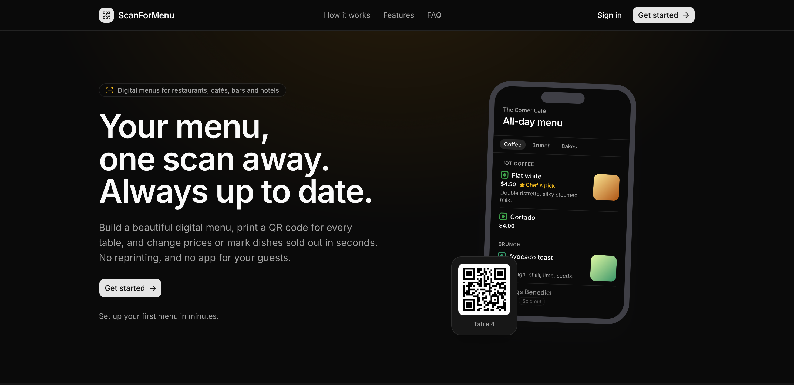

<p align="center">
  
</p>

<p align="center">
  <strong>QR code menus for restaurants, cafés, bars and hotels. Always up to date.</strong>
</p>

<p align="center">
  <a href="#features">Features</a> ·
  <a href="#how-it-works">How it works</a> ·
  <a href="#getting-started">Getting started</a> ·
  <a href="#deployment">Deployment</a>
</p>

---

ScanForMenu lets restaurants, cafés, bars and hotels publish digital menus that guests open by scanning a QR code at the table. Owners build their menus in a dashboard, upload dish photos, and print QR codes. When an item sells out or a price changes, guests see it on their next scan.



## Contents

- [Features](#features)
- [How it works](#how-it-works)
- [Tech stack](#tech-stack)
- [Getting started](#getting-started)
- [Environment variables](#environment-variables)
- [Database](#database)
- [Project structure](#project-structure)
- [Routes and API](#routes-and-api)
- [Roles and permissions](#roles-and-permissions)
- [Security](#security)
- [Scripts](#scripts)
- [Deployment](#deployment)

## Features

- **Public landing page.** A fast marketing page at `/` that explains the product, answers common questions, and sends visitors to sign up. Signed-in visitors see a link to their dashboard instead. It ships with `robots.txt` and `sitemap.xml`.
- **Multiple properties per account.** One account can manage several venues (restaurant, café, bar, hotel, resort, bakery, cloud kitchen, food court) and switch between them from the sidebar.
- **Team management.** Owners add people to a property by email and give each one an `owner`, `manager` or `staff` role. They can change roles or remove members later, and any member can leave.
- **Structured menu builder.** Menus are organized as categories, sub-categories and items. Each item has a price, a dietary marker (vegetarian, non-vegetarian, vegan, contains egg), an optional photo, and **featured** and **sold out** flags. You can reorder every level.
- **Media library.** Images upload straight from the browser to ImageKit and are served resized and optimized for each device.
- **Printable QR codes.** You can create several labelled codes per menu (one per table, the entrance, a flyer), each in one of several print-safe colors. You can download them as SVG for print or as a 1024 px PNG.
- **Scan analytics.** Every scan is counted and the time of the last scan is recorded.
- **Stable printed codes.** QR codes point at a short redirect link rather than the menu itself, so a printed code keeps working if the menu changes.
- **Public menu page.** A fast, mobile-first page at `/m/<slug>` that uses the property's own currency.
- **Accounts.** Email-and-password sign-up with code verification, or Google sign-in, all handled by Clerk. Profile, security, notification and theme settings are included.

## How it works

```
Guest scans QR ──► /q/<code> ──► count the scan (after the response is sent)
                        │
                        └─► 302 redirect ──► /m/<menu-slug> ──► public menu
```

1. An owner finds ScanForMenu on the landing page, signs up, and is sent to **onboarding** to create their first property.
2. In the dashboard they build a menu, upload photos and create QR codes.
3. Each QR code encodes `https://<your-domain>/q/<code>`, where `<code>` is a random 10-character string that can't be guessed.
4. When a guest scans it, the `/q/<code>` route looks up the menu, redirects the guest, and counts the scan in the background so the redirect never waits on it.
5. If a menu is switched off, guests see a friendly "unavailable" message and the printed code stays valid.

## Tech stack

| Area           | Technology                                                                 |
| -------------- | -------------------------------------------------------------------------- |
| Framework      | [Next.js 16](https://nextjs.org) (App Router, Cache Components, Turbopack) |
| UI             | React 19, [Tailwind CSS 4](https://tailwindcss.com), [shadcn/ui](https://ui.shadcn.com) on [Base UI](https://base-ui.com), Lucide icons |
| Authentication | [Clerk](https://clerk.com)                                                 |
| Database       | PostgreSQL on [Supabase](https://supabase.com), accessed through the transaction pooler |
| ORM            | [Drizzle ORM](https://orm.drizzle.team) and drizzle-kit                    |
| Cache          | [Upstash Redis](https://upstash.com) (optional)                            |
| Media          | [ImageKit](https://imagekit.io)                                            |
| Validation     | [Zod 4](https://zod.dev)                                                   |
| QR generation  | [`qrcode`](https://www.npmjs.com/package/qrcode)                           |

## Getting started

### Prerequisites

- Node.js 20 or later (developed on Node 24)
- npm
- Accounts on **Clerk**, **Supabase** and **ImageKit**. **Upstash** is optional.

### 1. Install dependencies

```bash
npm install
```

### 2. Configure the environment

```bash
cp .env.example .env
```

Fill in the values as described in [Environment variables](#environment-variables).

### 3. Set up Clerk

In the Clerk dashboard, under **User & authentication**:

- Turn on **Email** with **email verification code**.
- Turn on **Username**. The sign-up form collects one.
- Optionally, turn on **Google** as a social connection.

The app uses its own sign-in and sign-up pages at `/sign-in` and `/sign-up`. These match the `NEXT_PUBLIC_CLERK_SIGN_IN_URL` and `NEXT_PUBLIC_CLERK_SIGN_UP_URL` values in `.env.example`.

### 4. Create the database schema

```bash
npm run db:migrate
```

This applies the SQL migrations in [drizzle/](drizzle/) to the database in `DATABASE_URL`.

### 5. Start the development server

```bash
npm run dev
```

Open [http://localhost:3000](http://localhost:3000) to see the landing page. Select **Get started** to create an account, then follow onboarding to set up your first property.

> **Testing QR codes on a phone:** leave `NEXT_PUBLIC_APP_URL` empty in development. Codes then encode whatever address you opened the app on. Open the app on your computer's network address (for example `http://192.168.1.20:3000`) so a phone on the same network can follow the link.

## Environment variables

Every variable is listed in [.env.example](.env.example). Variables that start with `NEXT_PUBLIC_` are included in the browser bundle, so they must never hold secrets.

| Variable                            | Required | Exposed to browser | Description |
| ----------------------------------- | :------: | :----------------: | ----------- |
| `NEXT_PUBLIC_CLERK_PUBLISHABLE_KEY` | Yes      | Yes                | Clerk publishable key. |
| `CLERK_SECRET_KEY`                  | Yes      | No                 | Clerk secret key. |
| `NEXT_PUBLIC_CLERK_SIGN_IN_URL`     | Yes      | Yes                | Custom sign-in route. Use `/sign-in`. |
| `NEXT_PUBLIC_CLERK_SIGN_UP_URL`     | Yes      | Yes                | Custom sign-up route. Use `/sign-up`. |
| `DATABASE_URL`                      | Yes      | No                 | Supabase Postgres connection string. Use the **transaction pooler** (port `6543`) from **Dashboard → Connect**. |
| `IMAGEKIT_PRIVATE_KEY`              | Yes      | No                 | Signs uploads and calls the ImageKit API. Server only. |
| `NEXT_PUBLIC_IMAGEKIT_PUBLIC_KEY`   | Yes      | Yes                | ImageKit public key, used for browser uploads. |
| `NEXT_PUBLIC_IMAGEKIT_URL_ENDPOINT` | Yes      | Yes                | For example `https://ik.imagekit.io/your_imagekit_id`. |
| `NEXT_PUBLIC_APP_URL`               | In production | Yes           | The public address, for example `https://scanformenu.com`, with no trailing slash. Printed into QR codes, and used by the sitemap, `robots.txt` and the example QR codes on the landing page. |
| `UPSTASH_REDIS_REST_URL`            | No       | No                 | Upstash Redis REST URL. Leave empty to turn off caching. |
| `UPSTASH_REDIS_REST_TOKEN`          | No       | No                 | Upstash Redis REST token. |

> **Set `NEXT_PUBLIC_APP_URL` in production.** If it isn't set, QR codes take their address from the incoming request, so a code created on a preview deployment or on localhost would point there forever. The sitemap would also list `localhost` URLs.

## Database

The schema is defined in TypeScript in [lib/db/schema/](lib/db/schema/), and drizzle-kit generates SQL migrations from it into [drizzle/](drizzle/).

| Table                | Purpose |
| -------------------- | ------- |
| `users`              | A copy of each Clerk user, so the app's own tables can refer to them. |
| `user_preferences`   | Email notification settings for each user. A missing row means the defaults apply. |
| `properties`         | The tenant: a venue with its legal, size, contact, address and regional (currency, time zone) details. |
| `property_members`   | Links users to properties, with a role (`owner`, `manager` or `staff`). |
| `media_assets`       | Records for images stored in ImageKit, one folder per property. |
| `menus`              | Menus belonging to a property. Each has a globally unique slug for its public link. |
| `menu_categories`    | Top-level sections of a menu, such as "Beverages". |
| `menu_subcategories` | Sections inside a category, such as "Hot coffee". |
| `menu_items`         | Dishes and drinks, with price, dietary marker, photo and availability. |
| `qr_codes`           | QR codes with their label, color, stored SVG artwork and scan count. |

Deleting a property, menu or section also deletes everything inside it. Deleting a user or image clears the references to it (sets them to `NULL`), so menus and media stay intact.

**Row-level security** is turned on for every table and no policies are defined, so Supabase's public Data API can't read any data. The app connects directly as the database owner and enforces access rules on the server.

### Changing the schema

1. Edit the files in [lib/db/schema/](lib/db/schema/).
2. Generate a migration: `npm run db:generate`
3. Review the generated SQL in `drizzle/`.
4. Apply it: `npm run db:migrate`

Run `npm run db:studio` to browse the data in Drizzle Studio.

## Project structure

```
app/
├── page.tsx             Public landing page
├── robots.ts            robots.txt (keeps crawlers out of private and QR routes)
├── sitemap.ts           sitemap.xml
├── (auth)/              Sign-in, sign-up, sign-up continuation, Google SSO callback
├── onboarding/          First-run (and additional) property creation
├── dashboard/           Owner workspace: overview, property, menus, media,
│                        QR codes, team, account and settings
├── m/[slug]/            Public guest-facing menu
├── q/[code]/            QR scan redirect and scan counting
└── api/                 Route handlers (see below)
components/
├── ui/                  shadcn/ui primitives
├── landing/             Landing page pieces (auth-aware buttons, phone preview, QR art)
└── <feature>/           Feature components (auth, menus, media, qr, settings…)
lib/
├── db/                  Drizzle client and schema
├── cache/               Read-through Redis cache with time-to-live and invalidation
├── imagekit/            Server-only ImageKit client and upload signing
├── auth/                Session and workspace helpers
└── <domain>/            Each domain module (menus, media, properties, qr, team, users) has
                         constants.ts   shared by client and server
                         validation.ts  Zod schemas
                         service.ts     data access (server only)
                         actions.ts     Server Actions called by forms
hooks/                   Client hooks
public/                  Brand logo and README screenshots
drizzle/                 Generated SQL migrations
proxy.ts                 Clerk middleware (Next.js 16 "proxy")
```

Code is organized by domain. Server Actions in `actions.ts` validate input with the Zod schemas in `validation.ts`, check the user's role, and call `service.ts`. Service modules are the only code that reads or writes the database and the cache.

## Routes and API

### Pages

| Path                       | Access        | Description |
| -------------------------- | ------------- | ----------- |
| `/`                        | Public        | Landing page. Prerendered as a static shell; only the sign-in / dashboard buttons depend on the visitor. |
| `/sign-in`, `/sign-up`     | Public        | Authentication. |
| `/onboarding`              | Signed in     | Create a property. |
| `/dashboard/...`           | Signed in     | Workspace for the active property. |
| `/m/<slug>`                | Public        | Guest menu. |
| `/q/<code>`                | Public        | QR redirect. Never cached, so every scan is counted. Excluded from crawlers so bots don't inflate scan counts. |
| `/robots.txt`              | Public        | Crawler rules. |
| `/sitemap.xml`             | Public        | Public pages for search engines. |

### Route handlers

| Method | Path                                         | Description |
| ------ | -------------------------------------------- | ----------- |
| `GET`  | `/api/users/me`                              | Returns the signed-in user's database record. |
| `POST` | `/api/users/sync`                            | Creates or updates the user's database record from their Clerk profile. Called after sign-in. |
| `GET`  | `/api/media/upload-auth`                     | Returns a short-lived token that authorizes one upload to ImageKit. Owners and managers only. |
| `GET`  | `/api/qr-codes/<id>/download?format=svg\|png` | Downloads a QR code. Members of the property only. |

Everything else, such as creating, updating, deleting or reordering data, goes through Server Actions in `lib/*/actions.ts`.

## Roles and permissions

| Capability                                   | Owner | Manager | Staff |
| -------------------------------------------- | :---: | :-----: | :---: |
| View menus, media and QR codes               | ✓     | ✓       | ✓     |
| Edit menus, items and QR codes               | ✓     | ✓       |       |
| Upload and delete media                      | ✓     | ✓       |       |
| Edit property details and regional settings  | ✓     | ✓       |       |
| Add and remove members, change roles         | ✓     |         |       |
| Delete the property                          | ✓     |         |       |
| View the team and leave the property         | ✓     | ✓       | ✓     |

The user who creates a property becomes its owner. Every Server Action and route handler checks the role again on the server, so hiding a button in the interface is never the only protection.

### Adding a team member

1. The person signs up for ScanForMenu. They can stop at onboarding without creating a property.
2. An owner opens **Team** in the dashboard sidebar, selects **Add member**, enters the email the person signed up with, and chooses a role.
3. The property appears in the person's sidebar the next time they open the dashboard.

Owners change a member's role or remove them from the **⋯** menu next to their name. These rules protect the property:

- A property always keeps at least one owner. The last owner can't be demoted, removed or leave. Owner rows are locked during each change, so two owners acting at the same moment can't remove each other.
- Owners can't change their own role or remove themselves from the list. They use **Leave property** instead, and another owner has to change their role.

## Security

- **Secrets stay on the server.** Modules that hold credentials (`lib/db`, `lib/cache`, `lib/imagekit/server`) import `server-only`, so the build fails if client code ever imports them.
- **Uploads are signed and verified.** The browser uploads directly to ImageKit using a single-use token that expires after 10 minutes and is limited to the property's own folder. After the upload, the server fetches the file from ImageKit, rejects anything outside that folder, and deletes rejected uploads.
- **Only raster images are accepted:** JPG, PNG, WebP, AVIF and GIF, up to 10 MB. SVG is rejected because it can contain scripts.
- **QR codes can't be guessed.** Each code is 10 random URL-safe characters (60 bits).
- **Data is separated by property.** Every query is filtered by the active property, and the database's row-level security blocks Supabase's public API.
- **Cookies are protected.** The active-property cookie is `httpOnly`, `SameSite=Lax`, and `Secure` in production.

## Scripts

| Command               | Description |
| --------------------- | ----------- |
| `npm run dev`         | Start the development server. |
| `npm run build`       | Build for production. |
| `npm run start`       | Serve the production build. |
| `npm run lint`        | Run ESLint. |
| `npm run db:generate` | Generate a SQL migration from schema changes. |
| `npm run db:migrate`  | Apply pending migrations. |
| `npm run db:studio`   | Open Drizzle Studio. |

## Deployment

The app runs on any host that supports Next.js 16 with the Node.js runtime. [Vercel](https://vercel.com) is the simplest choice.

1. Add every variable from [Environment variables](#environment-variables) to the host. Set `NEXT_PUBLIC_APP_URL` to your production domain.
2. Run `npm run db:migrate` against the production database before or during the first deploy.
3. In Clerk, add the production domain and switch to production keys.
4. Optionally, configure Upstash Redis to cache menus, users and QR redirects in front of Postgres. The cache **fails open**: if Redis is slow or unavailable, the app reads from the database instead.
5. After the first deploy, open `https://<your-domain>/robots.txt` and `/sitemap.xml` to confirm they show your production domain, then submit the sitemap to Google Search Console.
